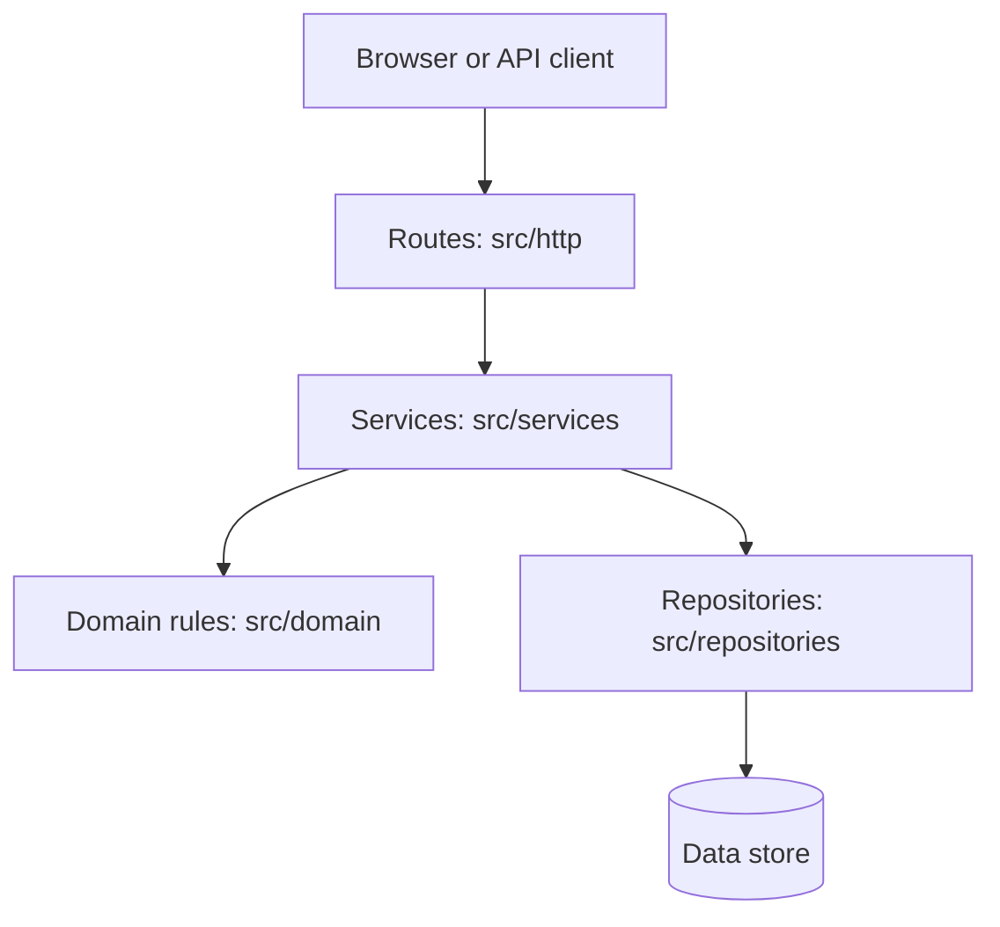
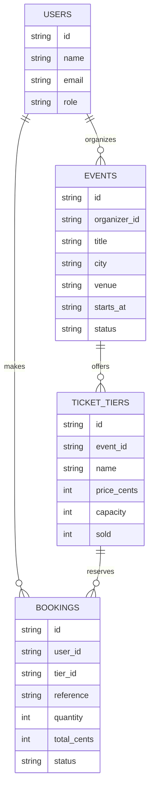
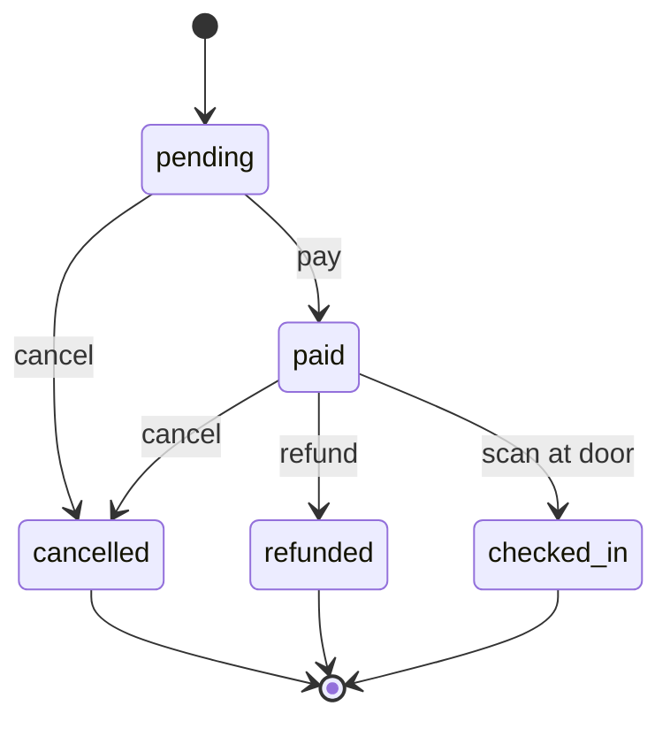

# Architecture (Build 3)

The app is built in layers. A request enters at the top and moves down; nothing ever calls upwards.

## 1. Layers

- **Routes** turn an HTTP request into a function call and the result back into an HTTP response; they may not hold business rules or touch data.
- **Services** run one use case (such as "book tickets") by combining rules and repositories; they may not know anything about HTTP.
- **Domain rules** decide what is allowed (capacity, validation, the booking life cycle); they may not do any I/O, so they stay easy to test.
- **Repositories** save and load data; they may not make business decisions.
- **Data store** keeps the data; it never calls back into the app.

(Since Build 4 all layers exist: `src/http` routes, `src/services`, `src/domain` rules and `src/repositories`. Services receive the repository and the payment gateway as arguments; they never import them. That lets Build 5 swap the in-memory repository for SQLite without touching the services.)

## 2. Data model

Money is always whole cents. Event status is DRAFT or PUBLISHED. Booking status follows the state machine below.

## 3. Booking life cycle

`cancelled`, `refunded` and `checked_in` are final. Any other move (for example paying a cancelled booking) is refused with `INVALID_TRANSITION`. The rules live in `src/domain/bookingStateMachine.js`.
